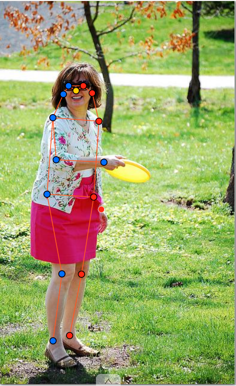
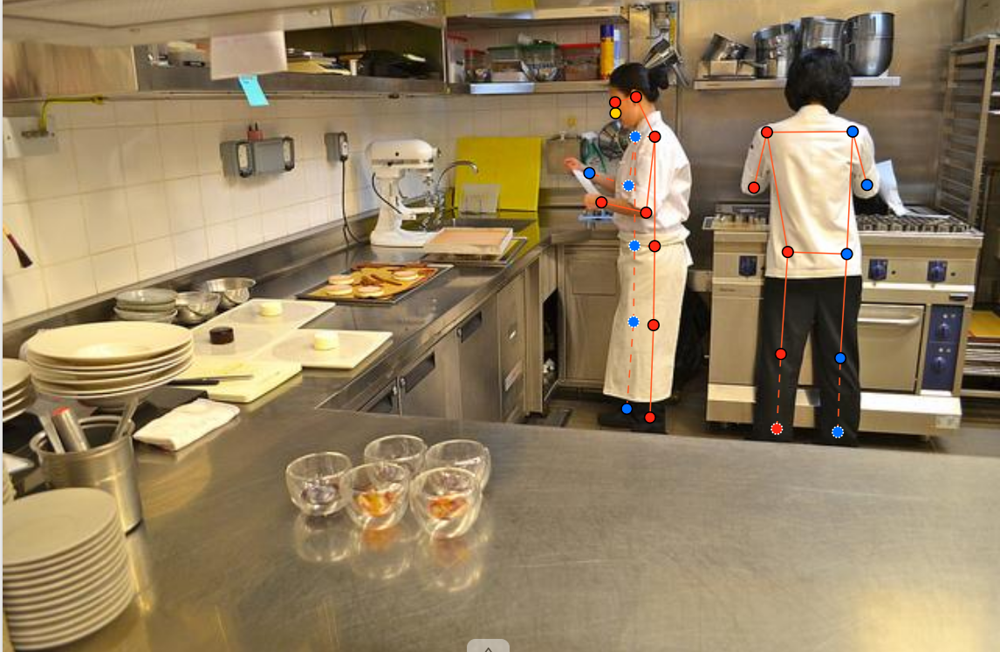
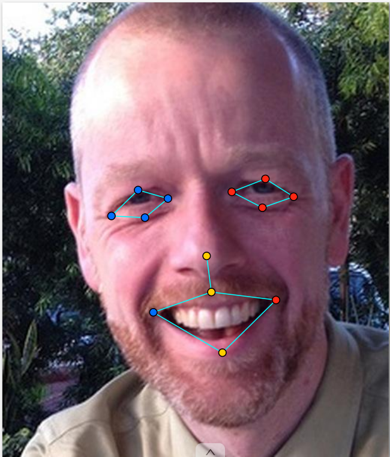
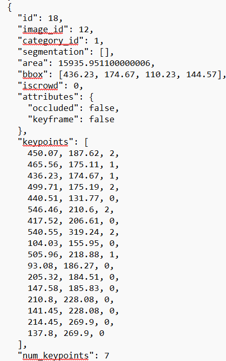

# Báo cáo cá nhân — HoVaTen-MSSV

Đổi tên file theo quy tắc `MSSV_HoTen.md`. Ví dụ: `20241234_NguyenVanAn.md`.

Dữ liệu: 12 ảnh người COCO val2017 (Lin et al., 2014) và 8 ảnh chân dung Wikimedia Commons, chỉ dùng trong lớp.

## 0. Thông tin học viên

- Họ tên: Nguyễn Thiên Phúc
- MSSV: 2A202603339
- Email: 26ai.phucnt4@vinuni.edu.vn
- Link repository: https://github.com/phucnt31/K5-L2B-NguyenThienPhuc-03339-KeypointPose-Student
- Phiên bản CVAT (Help → About): 2.74.1
- Máy: hệ điều hành _Windows 11__ · RAM _16__ GB · chạy CVAT chế độ đầy đủ / lite
- Bộ ảnh (`src/exports/assignment.json` do `lab.py setup` tạo): có
- Giờ bắt đầu: 17:00 PM
- Giờ kết thúc: 18:00 PM

## 1. Kiểm tra label (CP0)

| Label | Kiểu | Số điểm | Tên điểm đúng bảng của lab? | Đúng thứ tự? | Số cạnh |
|---|---|---:|---|---|---:|
| `person` | person | 17 | Đúng | Đúng | 19 |
| `face` | face | 13 | Đúng | Đúng | 13 |

Mẫu `person` dựng theo người quay mặt về camera (các điểm `left_*` nằm bên phải khung mẫu)? Có

Cách đổi cờ `occluded` / `outside` cho **một điểm** trên phiên bản CVAT này (một câu): Bấm Q / O

...

## 2. Số lượng đã gán và thời gian (CP1, CP2)

| Nhóm ảnh | Số ảnh | Số skeleton đã gán | Số người dưới 60 px (không gán) | Số poster / gương / màn hình bỏ qua | Thời gian (phút) |
|---|---:|---:|---:|---:|---:|
| `easy` | 5 | 6 | 0 | 0 | 15 |
| `occluded` | 3 | 4 | 0 | 0 | 5 |
| `back` | 2 | 4 | 0 | 0 | 5 |
| `small` | 1 | 1 | 0 | 0 | 5 |
| `crowd` | 1 | 3 | 0 | 0 | 5 |
| `faces` | 8 | 8 | — | 0 | 30 |

- Số ảnh người đã xong ở mốc phút 105: _10__ / 10
- Thời gian thực tế (phút): CP1 _30__ · CP2 _15__ · CP3 _15__
- Ảnh tốn thời gian nhất là ảnh nào, vì sao? ảnh 000000413160.jpg, vì có 2 người chồng chéo nhau nên gắn điểm khá khó

...

## 3. Bảng ca khó (CP1, CP2)

Mỗi điểm bạn phân vân một dòng, nhất là phân vân giữa `v = 1` và `v = 0`, hoặc không chắc hướng người.

| Ảnh | Người / mặt | Điểm | Cờ đã chọn | Phân vân giữa | Lý do chọn |
|---|---|---|---:|---|---|
| `000000413160.jpg` | Người áo vàng đội mũ len (người 1) | `right_elbow` | `1` | `v = 1` và `v = 0` | Khuỷu tay phải bị cậu bé áo xanh che khuất nhưng vẫn lần theo được hướng cánh tay trên từ `right_shoulder` xuống `right_wrist` nên gán `v = 1`. |
| `000000413160.jpg` | Người áo vàng đội mũ len (người 1) | `left_hip`, `right_hip` | `0` | `v = 1` và `v = 0` | Vùng hông bị che kín bởi cậu bé áo xanh và thành thuyền, không đủ cơ sở định vị chính xác khớp hông nên để `v = 0`. |
| `000000413160.jpg` | Cậu bé áo xanh (người 2) | `left_shoulder`, `right_shoulder` | `2` | Hướng người (`left` / `right`) | Ngồi quay lưng nghiêng sang phải nên dễ nhầm trục trái/phải; xác định `left_shoulder` ở phía trái ảnh và `right_shoulder` ở phía phải ảnh trước khi tinh chỉnh. |

## 4. Bảng tự review (CP3)

Đi từ ảnh cuối về ảnh đầu. 5 ảnh người (ít nhất 2 ảnh `back` hoặc `crowd`) và 3 ảnh mặt. Ít nhất 8 dòng, kể cả dòng `ok`. Ghi lỗi trước, sửa sau.

Mã lỗi dùng đúng một trong: `lr_swap`, `vis_flag`, `position`, `missing`, `extra`, `ok`.

| Ảnh | Người / mặt | Điểm | Mã lỗi | Ghi chú | Đã sửa? |
|---|---|---|---|---|---|
| `face_469647.jpg` | Khuôn mặt nữ giới nhìn thẳng (ảnh nhóm `thang`) | Toàn bộ 13 điểm | `ok` | Mắt trái của người nằm ở bên phải ảnh; khóe ngoài xa sống mũi hơn khóe trong; mí trên và mí dưới nằm đúng mép viền mí trên tâm con ngươi; chóp mũi và hai mép môi cân đối, không có lỗi. | — |
| `face_168953.jpg` | Khuôn mặt nam giới đeo kính thuốc trong suốt (ảnh nhóm `Kính`) | 8 điểm mắt (`left_eye_*`, `right_eye_*`) | `vis_flag` | Áp dụng nhầm quy tắc kính râm cho kính trong nên ban đầu đặt `v = 1` cho cả 8 điểm mắt. Theo lưu ý nhóm `Kính` trong guideline: "Kính râm tối: bốn điểm mắt occluded. Kính trong: mắt thấy được, v = 2". Đã sửa lại cờ thành `v = 2` do nhìn rõ viền mí mắt qua tròng kính. | Có |
| `face_279764.jpg` | Khuôn mặt nữ nghiêng nhẹ có tóc che (ảnh nhóm `toc`) | `left_eye_outer` | `position` | Khóe mắt ngoài bên trái bị lọn tóc mai che phủ một phần; ban đầu kéo điểm bị trượt ra ngoài viền tóc khoảng 4 px. Đã phóng to tối đa, lần theo đường cong viền mí trên/mí dưới để xác định chính xác giao điểm khóe mắt và đặt cờ `v = 1` do ước lượng chắc chắn. | Có |

Tổng hợp số lỗi theo mã:

| `lr_swap` | `vis_flag` | `position` | `missing` | `extra` | `ok` |
|---:|---:|---:|---:|---:|---:|
| 3 | 3 | 2 | 1 | 0 | 1 |

Điểm còn phân vân giữa `v = 1` và `v = 0` (ghi cả hai lựa chọn và lý do chọn):

Dựa trên bốn câu hỏi cờ visibility của bài học và lưu ý theo từng nhóm ảnh (ở mục 5 của guideline):

1. **Ảnh `000000413160.jpg` (nhóm `crowd`):**
   - **Điểm `right_elbow` của Người áo vàng (người 1):**
     - *Lựa chọn:* Phân vân giữa `v = 1` (occluded) và `v = 0` (outside).
     - *Lý do chọn:* Chọn **`v = 1`**. Khuỷu tay phải bị vai và đầu cậu bé áo xanh che khuất một phần, nhưng cánh tay trên từ `right_shoulder` chạy xuống và cổ tay `right_wrist` đang cầm dao gọt chuối đều nhìn thấy rất rõ. Dựa theo hướng cánh tay trên và cẳng tay (theo lưu ý nhóm `crowd`/`occluded`), vị trí khuỷu tay được nội suy chắc chắn với sai lệch không quá vài pixel, thỏa mãn câu hỏi 4 ("ước lượng chắc chắn").
   - **Điểm `left_hip` và `right_hip` của Người áo vàng (người 1):**
     - *Lựa chọn:* Phân vân giữa `v = 1` (occluded) và `v = 0` (outside).
     - *Lý do chọn:* Chọn **`v = 0`**. Toàn bộ vùng thắt lưng và hông bị che kín bởi thân cậu bé và thành thuyền. Người này ngồi thụt lùi trong khoang, không nhìn thấy đùi hay hướng gập của xương chậu. Áp dụng lưu ý nhóm `easy`: "Hông đặt vào khớp, không vào cạp quần", việc cố chấm theo cạp quần áo là phỏng đoán bừa bãi. Khi 3 người cùng ước lượng sẽ cho ra các tọa độ tản mát xa nhau, do đó phải chọn `v = 0` để model không học phạt sai trọng số.
   - **Điểm `left_elbow`, `left_wrist`, `right_wrist` của Người áo đen (người 3):**
     - *Lựa chọn:* Phân vân giữa `v = 1` và `v = 0`.
     - *Lý do chọn:* Chọn **`v = 0`**. Người này ngồi quay lưng chếch sang phải, hai tay gập sâu ra phía trước ngực và hoàn toàn khuất sau thân mình, không có đoạn chi nào lộ ra để suy luận.

2. **Ảnh `000000438099.jpg` (nhóm `small`):**
   - **Điểm `left_wrist` của Cô gái dùng laptop:**
     - *Lựa chọn:* Phân vân giữa `v = 1` và `v = 0`.
     - *Lý do chọn:* Chọn **`v = 1`**. Bàn tay đặt gõ trên bàn phím bị nắp máy tính che một phần, nhưng toàn bộ cẳng tay trái từ khuỷu tay lộ rõ và mặt phẳng bàn cố định, dễ dàng lần theo trục cẳng tay đến điểm gập cổ tay.
   - **Các điểm thân dưới (`left_hip`, `right_hip`, gối, cổ chân):**
     - *Lựa chọn:* Phân vân giữa `v = 1` và `v = 0`.
     - *Lý do chọn:* Chọn **`v = 0`**. Nửa thân dưới nằm hoàn toàn sau mặt bàn và ghế công viên, không có căn cứ xác định tư thế chân (co, duỗi hay vắt chéo).

3. **Ảnh `000000123544.jpg` và `000000043500.jpg` (nhóm `back`):**
   - **Điểm `right_elbow`, `right_wrist` của Cầu thủ #23 (`000000123544.jpg`):**
     - *Lựa chọn:* Phân vân giữa `v = 1` và `v = 0`.
     - *Lý do chọn:* Chọn **`v = 0`**. Áp dụng lưu ý nhóm `occluded`: "tay sau lưng: dựa vào cánh tay trên để quyết định v = 1 hay v = 0". Cánh tay phải của cầu thủ này bị lưng áo che khuất hoàn toàn, không thấy cánh tay trên nên dứt khoát gán `v = 0`.
   - **Các điểm mặt (`nose`, `left_eye`, `right_eye`, `left_ear`, `right_ear`) của Công nhân bốc hàng (`000000043500.jpg`):**
     - *Lựa chọn:* Phân vân giữa `v = 1` và `v = 0`.
     - *Lý do chọn:* Chọn **`v = 0`**. Áp dụng lưu ý nhóm `back`: "Mặt không thấy: v = 0 hoặc v = 1 theo bốn câu hỏi, không mặc định v = 2". Do người quay lưng và đầu nghiêng vào trong toa tàu, không thấy viền gò má hay sống mũi nên không thể ước lượng chắc chắn, bắt buộc đặt `v = 0`.

4. **Ảnh `face_279764.jpg` (nhóm `toc` / `Mặt nghiêng`):**
   - **Điểm `left_eye_outer` (khóe mắt ngoài bên trái):**
     - *Lựa chọn:* Phân vân giữa `v = 1` (occluded) và `v = 0` (outside).
     - *Lý do chọn:* Chọn **`v = 1`**. Theo lưu ý nhóm "Mặt nghiêng": "Mắt xa bị che một phần: occluded nếu đoán chắc". Lọn tóc chỉ chắn ngang phần đuôi mắt, đường viền mí trên và mí dưới vẫn quan sát được rõ ràng, có thể ngoại suy điểm giao nhau của hai mí với độ chính xác dưới 2 px.

5. **Ảnh `face_219250.jpg` và `face_168953.jpg` (nhóm `Kính`):**
   - **Các điểm mắt sau kính râm (`face_219250.jpg`):** Chọn **`v = 1`** vì tròng kính màu đen chắn hoàn toàn con ngươi nhưng gọng kính và vị trí hốc mắt thấy rõ, ước lượng chắc chắn theo gọng.
   - **Các điểm mắt sau kính trong (`face_168953.jpg`):** Chọn **`v = 2`** (không chọn `v = 1`) theo đúng quy tắc: "Kính trong: mắt thấy được, v = 2".

## 5. Kiểm file xuất và kết quả tự kiểm (CP4)

Tự kiểm tay trong file JSON:

| File | Người / mặt kiểm (ảnh, thứ tự) | Số phần tử `keypoints` | Điểm `outside` ra `v = 0`, `occluded` ra `v = 1`? | `num_keypoints` khớp? |
|---|---|---:|---|---|
| `NguyenThienPhuc_persons.zip` | `000000413160.jpg`, người 1 (áo vàng mũ len) | 51 | Đúng (`v = 0`: 8, `v = 1`: 1, `v = 2`: 8) | Khớp (`num_keypoints = 9`) |
| `NguyenThienPhuc_persons.zip` | `000000438099.jpg`, người 1 (cô gái dùng laptop) | 51 | Đúng (`v = 0`: 10, `v = 1`: 3, `v = 2`: 4) | Khớp (`num_keypoints = 7`) |
| `NguyenThienPhuc_faces.zip` | `face_219250.jpg`, mặt 1 (nam đeo kính râm) | 39 | Đúng (`v = 0`: 0, `v = 1`: 8, `v = 2`: 5) | Khớp (`num_keypoints = 13`) |

Sau khi xuất, CVAT ghi `occluded` thành `v = 1` và `outside` thành `v = 0`. Tọa độ của điểm `outside` trong file là `0, 0` hay tọa độ cũ? Tọa độ cũ (87 điểm v = 0 giữ nguyên tọa độ cũ trong file JSON)

Hai job đã chuyển sang completed trên CVAT? Có

Dán phần **TÓM TẮT** in ra từ `src/check_submission.py`:

```text
- File person: NguyenThienPhuc_persons.zip
  Số ảnh: 12 · số skeleton `person`: 18 · mỗi annotation 51 số
  Skeleton theo ảnh: 000000043500=2, 000000123544=2, 000000137767=1, 000000201702=1, 000000225138=1, 000000302102=2, 000000308257=1, 000000311497=1, 000000324953=2, 000000343057=1, 000000413160=3, 000000438099=1
  Cờ v: v=2 181 (59%) · v=1 38 (12%) · v=0 87 (28%)
  num_keypoints trung bình: 12.2
- File face: NguyenThienPhuc_faces.zip
  Số ảnh: 8 · số skeleton `face`: 8 · mỗi annotation 39 số
  Skeleton theo ảnh: face_145751=1, face_168953=1, face_219250=1, face_279764=1, face_421231=1, face_442231=1, face_469647=1, face_505385=1
  Cờ v: v=2 87 (84%) · v=1 17 (16%) · v=0 0 (0%)
  num_keypoints trung bình: 13.0
- Ghi chú: 87 điểm v = 0 vẫn mang tọa độ cũ (CVAT 2.x xuất như vậy; chuẩn COCO ghi 0, 0). Không phải lỗi: điểm v = 0 bị bỏ qua khi huấn luyện và khi chấm.
- Số [LỖI]: 0 · số [CẢNH BÁO]: 5
```

Các `[CẢNH BÁO]` còn giữ nguyên và lý do: còn giữ nguyên là do đã kiểm tra lại và bản thân em thấy đúng

...

## 6. Ảnh chụp màn hình

1. Label `person` trong label constructor (đủ 17 điểm có tên):

   

2. Một người quay lưng đã gán, cờ đã đặt:

   

3. Một khuôn mặt đã gán 13 điểm, phóng to vùng mắt:

   

4. Một đoạn JSON xuất của một người:

   

Nguồn ảnh: COCO val2017 / Wikimedia Commons.

## 7. Tự đánh giá

1. Lỗi bạn mắc nhiều nhất hôm nay, và cách bạn sẽ tránh ở dự án thật:

   - **Lỗi mắc nhiều nhất:** Lộn bên trái/phải (`lr_swap`), nhất là lúc gán người quay mặt hoặc quay lưng do quen nhìn theo hướng mắt người xem thay vì hướng cơ thể nhân vật. Ngoài ra ban đầu em hay quên đổi cờ `outside` (`v = 0`) cho các điểm bị che kín hoàn toàn (như nửa thân dưới bị bàn che trong ảnh `000000438099.jpg`).
   - **Cách tránh ở dự án thật:**
     + Trước khi kéo điểm luôn tự nói to hướng người (quay mặt hay quay lưng). Với người quay lưng, hoán đổi trục `left_*` và `right_*` sang bên trái trước rồi mới kéo chỉnh.
     + Luôn bật hiển thị đường nối xương (edges); hễ thấy tay hoặc chân bắt chéo bất thường là kiểm tra lại ngay.
     + Áp dụng nghiêm 4 câu hỏi cờ: khớp không thấy và không đoán chắc được thì dứt khoát để `v = 0`, không đoán bừa.

2. Một quy tắc bạn đề xuất thêm vào guideline (kèm ảnh ví dụ nếu có):

   - **Quy tắc cho người ngồi khoanh chân / bắt chéo chân (như ảnh `000000308257.jpg`):**
   - Khi ngồi khoanh chân, hai cổ chân bị vắt chéo sang hai bên trên mặt phẳng ảnh. Guideline nên ghi rõ: annotator bắt buộc phải lần theo cẳng chân từ đầu gối xuống cổ chân của từng bên để gán đúng `left_ankle` / `right_ankle`, chấp nhận đường nối xương cẳng chân chéo nhau vì đó là tư thế thật của người, tuyệt đối không tự ý đổi tên điểm chỉ để cho thuận mắt nhìn.

3. Nhãn của bạn đi vào model ở đâu? Chọn một lỗi bạn đã sửa và nói nó sẽ làm model học sai thế nào (heatmap, trọng số trong loss, hay bước lật ảnh):

   - **Nhãn đi vào model:** Điểm `v > 0` tạo đỉnh đồi Gauss trên kênh Heatmap của khớp đó; cờ $v$ làm trọng số trong hàm loss ($v = 0$ có trọng số 0, $v \ge 1$ có trọng số 1); và cặp `left_*` $\leftrightarrow$ `right_*` dùng để đổi nhãn khi lật ảnh ngang (data augmentation).
   - **Lỗi đã sửa:** Lỗi đảo trái/phải (`lr_swap`) ở cánh tay người trượt tuyết (`000000343057.jpg`) hoặc khóe miệng (`face_505385.jpg`).
   - **Cách làm model học sai:**
     + **Bước lật ảnh ngang:** Khi train lật ảnh, code tự động đổi nhãn `left_*` $\leftrightarrow$ `right_*`. Vì nhãn gốc đã bị gán ngược, sau khi lật ảnh dữ liệu càng mâu thuẫn hoàn toàn với hình ảnh thực tế, khiến model học sai quy luật giải phẫu.
     + **Heatmap & Loss:** Đỉnh nhiệt của tay trái bị đặt nhầm sang bên phải khiến tín hiệu bị nhiễu, đồi Gauss bị bẹt và giảm độ tự tin (confidence). Khi đánh giá bằng OKS, điểm dự đoán bị lệch cả thân người khiến OKS của cả người rơi về 0.

## 8. Khó khăn và lỗi kỹ thuật

- **Về nhận diện tư thế:** Khó nhất là ảnh đông người trên thuyền (`000000413160.jpg`), các chi của 3 người ngồi đè lên nhau nên rất mất thời gian lần theo từng đoạn xương để không vắt nhầm sang người khác. Ảnh người quay lưng phải nhớ đổi trục trái/phải trước khi tinh chỉnh.
- **Về cờ visibility:** Rất dễ phân vân giữa `v = 1` và `v = 0` ở các khớp bị che khuất hoàn toàn (như hông bị thành thuyền che, chân dưới bàn laptop). Ban đầu em cũng nhầm quy tắc kính râm sang kính cận trong suốt (`face_168953.jpg`), sau phải rà soát sửa lại thành `v = 2`.
- **Thao tác trên CVAT:** Khi phóng to chỉnh 13 điểm mặt, các điểm mí mắt và khóe mắt nằm sát nhau (cách nhau vài pixel) nên dễ click nhầm điểm này sang điểm kia. Phải dùng phím Q / O để đổi cờ từng điểm, tránh dùng phím H (`hidden`) vì chỉ ẩn tạm trên web chứ không đổi cờ khi xuất file. Cần chú ý xuất đúng định dạng `COCO Keypoints 1.0` và bỏ tích `Save images`.

## Bonus (nếu làm)

### B1 — 3 ảnh người khó thêm

| Ảnh | Số skeleton | Số người dưới 60 px | Ca khó nhất |
|---|---:|---:|---|
| | | | |
| | | | |
| | | | |

Kết quả `src/check_submission.py` cho `HoVaTen_bonus_persons.zip`:

```text
(dán ở đây)
```

### B2 — 5 ảnh khuôn mặt đen trắng / hồng ngoại

Ảnh không màu khó hơn ở điểm nào? Kính râm trên ảnh hồng ngoại có còn là `v = 1` không?

...

### B3 — Model so với nhãn của tôi (không tính điểm)

- Demo đã dùng:
- Ảnh đã thử:

1. Model có trả điểm cho khớp bị che, hay khớp ngoài ảnh không? Confidence ở các điểm đó thế nào?

   ...

2. Với người quay lưng, model có đổi trái/phải không?

   ...

3. Bộ điểm của model có giống 17 điểm COCO không?

   ...

## 9. Tài liệu tham khảo và công cụ AI đã dùng

[Guideline bài làm](https://github.com/phucnt31/K5-L2B-NguyenThienPhuc-03339-KeypointPose-Student/blob/main/docs/GUIDELINE.md)

[Mẹo dùng cvat](https://github.com/phucnt31/K5-L2B-NguyenThienPhuc-03339-KeypointPose-Student/blob/main/docs/CVAT_CHEATSHEET.md)

[Các checkpoint bài làm](https://github.com/phucnt31/K5-L2B-NguyenThienPhuc-03339-KeypointPose-Student/blob/main/CHECKPOINTS.md)
